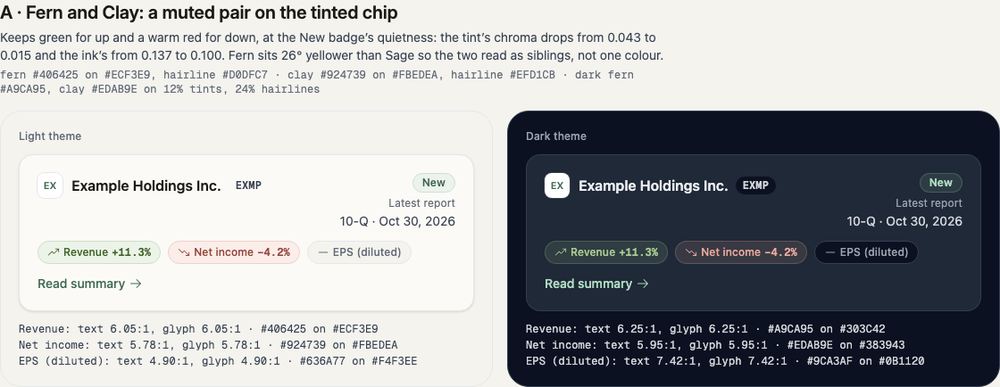
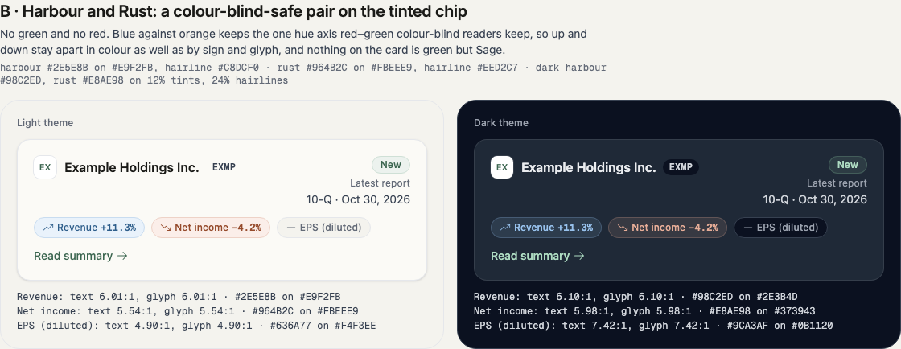
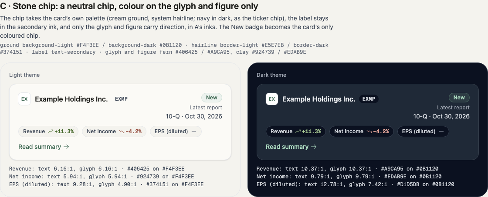
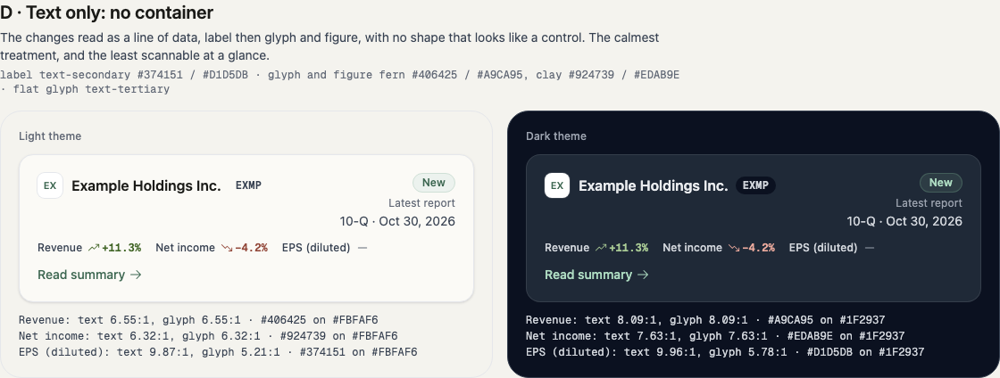
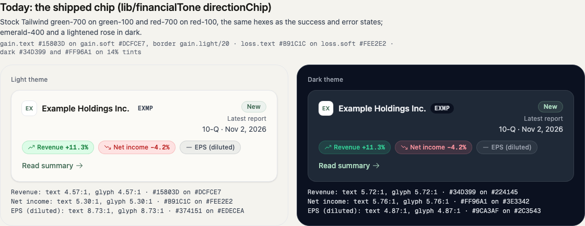
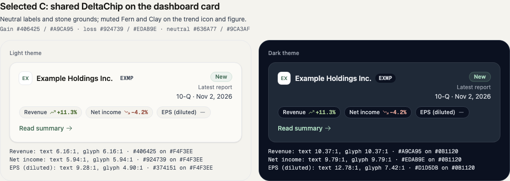
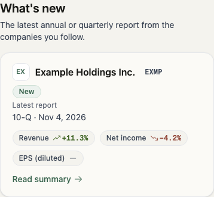
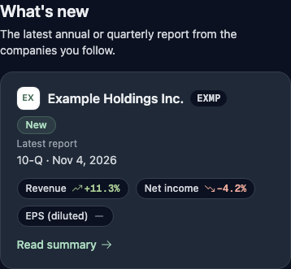
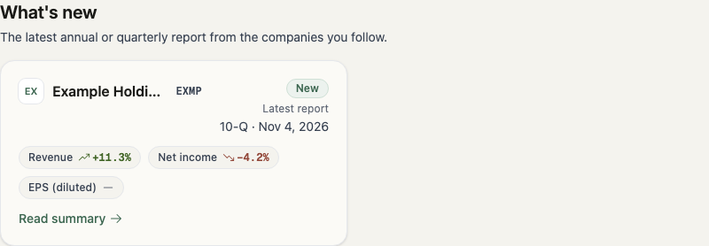
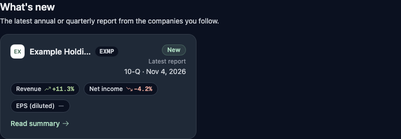

# Financial delta colour audit and selected treatment

Decision: option C (neutral stone pills), selected by the founder on 2026-11-04. Screenshots use explicitly fictional company data. The temporary `/dev/delta-pills` comparison route was used locally and removed before commit; it does not ship.

## Root cause and system alignment

The dashboard was already consuming the design system: `FilingFeed` renders `WhatChangedCard`, whose private `MetricChip` used `lib/financialTone.directionChip`. At investigation baseline `c440c238`, `frontend/features/dashboard/components/WhatChangedCard.tsx:64–89`, `frontend/lib/financialTone.ts:55–59` and `frontend/tailwind.config.js:21–56` show that the saturated green/red came from the financial token palette, not component hardcoding or a library default. In light mode the financial text values also equalled the success/error values, despite their separate semantic names.

**Verdict: Partially aligned.** The component followed the documented financial recipe, Phosphor icons and shared card/badge components. The underlying palette did not meet the requested visual relationship to Sage, and the chip markup was duplicated in the auth example. Dedicated financial positive/negative/neutral tokens **do exist**, distinct in role from status and brand tokens. The authoritative source is `frontend/tailwind.config.js`; `DESIGN.md`, `frontend/DESIGN_SYSTEM.md` and `.impeccable/design.json` document it.

The old chip is a span, with no independent event handler or tab stop. However, its **whole card is a Link**, and clicking the chip activates that card. Its border, rounding and padding can suggest a separate button; the new chip retains a quieter annotation container and adds no interaction. This is not an independently clickable metric control.

## Original rendered colours and accessibility

Rounded 8-bit alpha compositing on the card (`#FBFAF6` light, `#1F2937` dark), followed by WCAG relative luminance. Icon inherits text ink. The light card hovers to white; opaque positive/negative backgrounds stay unchanged. Dark backgrounds remain the dark panel on hover.

| Theme/state | Background | Painted border | Text/icon | Text and icon contrast | Border/card contrast |
|---|---|---|---|---|---|
| Light positive | #DCFCE7 | #B4EAC8 | #15803D | 4.57:1 | 1.29:1 |
| Light negative | #FEE2E2 | #F7BCBC | #B91C1C | 5.30:1 | 1.56:1 |
| Light neutral | #EDECEA | #D3D4D5 | #374151 | 8.73:1 | 1.42:1 |
| Dark positive | #224145 | #265E56 | #34D399 | 5.72:1 | 1.97:1 |
| Dark negative | #3E3342 | #654755 | #FF96A1 | 5.76:1 | 1.81:1 |
| Dark neutral | #2C3543 | #424B59 | #9CA3AF | 4.87:1 | 1.67:1 |

Border source: positive/negative light graphic token at 20%, dark ink at 20%, composited over the chip background (CSS backgrounds extend under borders). Neutral backgrounds use flat/10 and borders flat/20. Dark positive/negative backgrounds use their soft rgba tokens at 14%. The old neutral chip on hovered white is #F0F1F2, border #D5D8DB, text 9.11:1. On the cream page, old positive/negative/neutral text contrast is 4.57/5.30/8.24; on navy it is 7.65/7.58/6.41.

All original chip labels meet WCAG 2.2 AA small-text 4.5:1; icons exceed 3:1. Borders are below 3:1 but decorative: neither direction nor a separate control depends on their outline. Trend glyph plus signed figures convey direction without colour. When the server has no displayable moving figure, screen-reader direction words are retained. Flat had a decorative minus with no accessible direction word; the shared component now supplies “unchanged”. Dark mode is supported via `.dark`, with saved user preference and light default (`DESIGN_SYSTEM.md`, Theme mechanics).

Sage neighbours: the New badge uses #3C6650 on #ECF2EE (5.77:1) and #AEDCC2 on its dark tint (7.52:1 on panel); the summary link is 6.27:1 light / 9.66:1 dark. These remain unchanged.

## Occurrence census

Paths below are under `frontend/`. Consumers keep their existing presentation unless they are financial chips/tiles; changing their semantic token source updates all of their direction inks.

| File/component | Occurrences / treatment |
|---|---|
| `features/dashboard/components/FilingFeed.tsx` | What's new heading and six-card grid; mounts WhatChangedCard |
| `features/dashboard/components/WhatChangedCard.tsx` | MetricChip, every feed metric; now shared DeltaChip |
| `features/auth/components/AuthShell.tsx` | Revenue +6.4% YoY example chip; now shared DeltaChip with Phosphor glyph |
| `lib/financialTone.ts` | directionText, dataDirectionText, directionChip recipes |
| `components/ui/Badge.tsx` | beat/miss variants; neutral grounds, semantic inks (no current production callers found) |
| `components/ui/DataTable.tsx` | gain/loss/flat cell tone map; affects summary and insider table cells |
| `features/summaries/components/FinancialMetricsTable.tsx` | Desktop change-cell tone through DataTable; mobile changeToneClass; trend icons |
| `features/analysis/components/KpiStrip.tsx` | Growth text through dataDirectionText |
| `features/analysis/components/MetricsTable.tsx` | Period/comparison and window changes through dataDirectionText (two locations) |
| `features/companies/components/CompanySearch.tsx` | Stock quote change through directionText/directionOf |
| `features/filings/components/WhatChanged.tsx` | gain/loss/flat TONE_TEXT; filing change report |
| `features/marketing/components/ChangeReportDemo.tsx` | Reuses filing WhatChanged; inherits changed tokens |
| `features/marketing/components/HeroExample.tsx` | Sample metric deltas through directionText |
| `features/calendar/components/EventRow.tsx` | EpsFigure actual-versus-estimate direction ink |
| `features/insiders/components/InsiderActivityPanel.tsx` | Transaction DataTable tone; net-buy/sell headline; buy/sell tiles (two); tiles now neutral |

Searches of tracked frontend sources found no hardcoded green/red utilities for this pattern. Copilot answer rendering has no financial gain/loss colouring. Chart series use the separate categorical palette, not gain/loss; no chart series recolouring is needed. Status success/error UI colours remain untouched. Flat also serves neutral input/checkbox border states; its light value is adjusted from #6B7280 to #636A77 to meet text contrast on cream while remaining a neutral border.

## Four evaluated options

All options preserve signed figures and Phosphor trend/minus icons. Neutral uses existing secondary labels (#374151 / #D1D5DB) and tertiary/flat direction ink (#636A77 / #9CA3AF). Light/dark token values are listed explicitly; tints/borders in dark are composited on the card. Decorative borders need not meet the 3:1 information-bearing graphic requirement.

### A — Fern and Clay tinted pills

Positive: ink #406425 / #A9CA95; light fill #ECF3E9, border #D0DFC7. Negative: ink #924739 / #EDAB9E; fill #FBEDEA, border #EFD1CB. Dark fill is each ink at 12%, border at 24%: positive fill/border #303C42/#4D5E56, negative #383943/#635459. Neutral fill #F4F3EE / #0B1120 and border #E5E7EB / #374151.

Familiar financial conventions, with substantially less saturated inks and tints beside Sage. The New badge remains Sage, but A still introduces another green-tinted shape. Red/green colour deficiencies still need the sign and glyph. Positive/negative/neutral text and icon contrast: **6.05/5.78/4.90 light**, **6.25/5.95/7.42 dark**.

### B — Harbour and Rust tinted pills

Positive: ink #2E5E8B / #98C2ED; light fill #E9F2FB, border #C8DCF0. Negative: ink #964B2C / #E8AE98; fill #FBEEE9, border #EED2C7. Dark fill/border at 12%/24%: positive #2E3B4D/#475B73, negative #373943/#615557. Neutral as A.

Blue/orange separates the two directions for red/green colour deficiencies and leaves Sage as the only green. It introduces a less conventional financial mapping; Rust can resemble warning amber even though its semantic tokens remain separate. Positive/negative/neutral text and icon contrast: **6.01/5.54/4.90 light**, **6.10/5.98/7.42 dark**. Colour is supplemental, never the sole direction cue.

### C — Neutral stone pills (selected)

Every state uses background #F4F3EE / #0B1120 and border #E5E7EB / #374151. Labels use secondary #374151 / #D1D5DB. Only the glyph and figure use A's Fern/Clay inks; flat uses #636A77 / #9CA3AF.

This ties the annotations to the card palette and leaves New as the card's coloured badge. It retains useful grouping at the cost of a mild button-like shape. The smaller coloured area reduces competition with Sage without discarding familiar direction colours. Figure/icon positive/negative/flat contrast: **6.16/5.94/4.90 light**, **10.37/9.79/7.42 dark**; neutral labels **9.28/12.78**. The original dashboard suppresses a zero figure; this behaviour is retained with a visible minus glyph and screen-reader “unchanged”.

### D — Text-only deltas

No fill or border. Secondary labels and the same Fern/Clay/flat inks as C, directly on panel #FBFAF6 / #1F2937.

The calmest presentation, with no separate control-like silhouette and the strongest visual priority for Sage actions and New. It loses the grouping affordance of a chip, particularly on dense cards. Figure/icon positive/negative/flat contrast: **6.55/6.32/5.21 light**, **8.09/7.63/5.78 dark**; secondary labels **9.87/9.96**. Light hover-to-white only increases these ratios.

## Implementation and evidence

Existing `gain`, `loss`, and `flat` semantic tokens are updated in their source layer rather than adding competing aliases. Analysis data inks retain their APCA |Lc| >= 75 requirement: gain #406425 / #C0D9B1, loss #90493B / #F9C7BC. `DeltaChip` owns the neutral shell and separate label/direction ink; it preserves server tone independently from direction. The source documentation and sidecar are updated together.

Browser captures: light/dark at desktop and 390px; actual chips also checked at 200% root font size with no chip overflow (the temporary preview's prose caused page overflow at that size and is removed). Focused tests verify token contrast, server tone mapping, accessible direction, wrapping and documentation parity. Local validation: lint, type-check and production build passed; 362 unit files / 6,749 tests passed; all 53 dashboard browser layout tests passed, including seven chip cases at 200% text. Browser tests measure actual text containment; the focused unit test checks wrapping classes. Deployment verification is pending and will be recorded on the PR.

Before:

After:

Mobile:

