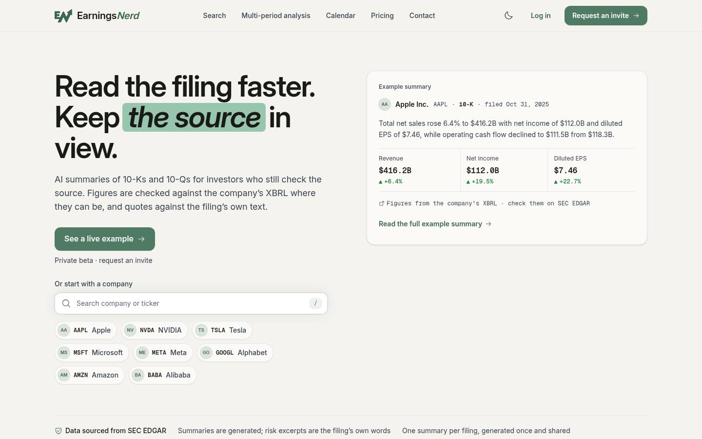

# PR #1340: audit closeout addendum

23 October 2026. Reconciled against main `b3d3cb1118906dad44dfc1085136ad0f86fb956d` and live GitHub PR metadata. This replaces the **implementation queue**, not the evidence, in the [15 October report](../design-system-review-2026-10/REPORT.md). The original source remains `1f12fc835fcbf525042473ab0e988b4827734f38`; its 339 captures, dates, measurements and scores remain historical.

Final main recheck: `eb20bd1793a5e651d75b04ae563ffe877a617156` through #1529. Its billing service/router, test and task-record changes leave the audited runtime paths and the four tested frontend specs unchanged. That was the 21:41 UTC snapshot; the dated continuation below records later changes.

**Disposition: retain a narrowed remainder; accept the original as an archive.** GitHub already records [#1340](https://github.com/neilmac91/EarningsNerd/pull/1340) merged on 23 October at 21:08:02 UTC (23:08:02 Europe/Zurich), commit `37e33944e2128111e4eb7ca280fbb3be2f672a71`. That happened before this closeout read. #1340 itself is no longer held for merge or closure; the closeout draft #1541 remains held. Retiring the entire audit as superseded would lose surviving interaction, semantic and copy defects. Its old 16-item implementation plan is retired by this addendum; only the bounded remainder below is proposed. This record itself authorizes no implementation, merge, deployment, generation or production change. The user subsequently authorized continuing the recommended approach; three bounded frontend fixes are prepared as separate drafts, with merge approval still held.

## Evidence boundary

The original closeout checked current source, commit ancestry, open PR patches and 33 existing unit tests. Browser capture tools were unavailable for that review. **“Still reproducible (source)” means the exact source-level defect persists; it does not claim a new browser click, pixel measurement or performance sample.** DS-06 follows the existing header owners and their scoped evidence; DS-12 still requires new visual evidence before implementation. Old CLS, contrast and overflow numbers retain their original dates.

The later [23 October capture set](../../docs/brand/stress/closeout-2026-10-23/README.md), source `5897d602`, was inspected as separately dated evidence. It uses a fallback hero, mocked signed-out data and failed external logo requests; it cannot clear the live hero badge, signed-in menus, delayed authentication or loaded company logos. Main has changed since those captures. The [verification receipt](verification.json) records the checked revisions, archive preservation and PR snapshot. The 15 October scores are not rescored here; [#1518's later assessment](../../docs/brand/09-stress-test.md) has its own scope and date.

## Every original system finding

| Finding | Disposition | Current evidence and surviving scope |
|---|---|---|
| DS-01: hero financial values overlap | **Resolved** | [#1462](https://github.com/neilmac91/EarningsNerd/pull/1462) replaces fixed thirds/nowrap with content-sized wrapping groups in [HeroExample](../../frontend/features/marketing/components/HeroExample.tsx). Current unit contract passes; existing `reflow-200.spec.ts` covers the figure strip. The different live badge issue is E156, not the old P0. |
| DS-02: secondary header hides behind global bar | **Resolved** | [#1521](https://github.com/neilmac91/EarningsNerd/pull/1521) makes [SecondaryHeader](../../frontend/components/SecondaryHeader.tsx) scroll with the page. The site header is the only sticky bar. **Discard the old “preserve stickiness and offset” recommendation.** Current header contract test passes. |
| DS-03: modal sheets leave header active | **Still reproducible (source)** | [Sheet focus lifecycle](../../frontend/features/filings/components/copilot/useSheetFocusTrap.ts) traps Tab/Escape but does not make outside chrome inert. Source/standalone Ask sheets remain below the z-50 header. Retain outside pointer ownership with existing focus restoration; recapture the exact interaction as the first acceptance check. [#1530](https://github.com/neilmac91/EarningsNerd/pull/1530) changes source vocabulary, not this contract. |
| DS-04: page frames omit main | **Still reproducible (source)** | [AuthShell](../../frontend/features/auth/components/AuthShell.tsx), settings loading/loaded frames, TickerFilingsView and route/global/account error frames still use div wrappers. The root skip target is a div; replacing it with a universal main would nest other routes' landmarks. Retain a bounded frame correction, including all six auth routes. |
| DS-05: whole-page guidance starts at h3 | **Still reproducible (source), narrowed** | Dashboard's account failure now uses h1 via [#1474](https://github.com/neilmac91/EarningsNerd/pull/1474); six current error-heading tests pass. Only the invalid, missing/failed and unsupported branches of [company page-client](../../frontend/app/company/%5Bticker%5D/page-client.tsx) still fall back to GuidanceCard's h3 before the normal page h1. Combine with DS-04. |
| DS-06: authentication moves header geometry | **Height fix resolved; remainder already owned: E173/E175** | Correction to the initial addendum: E174 already had a stable-control-height ruling in [#1538 review 5634660486](https://github.com/neilmac91/EarningsNerd/pull/1538#pullrequestreview-5634660486). [#1544](https://github.com/neilmac91/EarningsNerd/pull/1544) subsequently merged that bounded height fix at 22:52:47 UTC (`629783b9`). Its newer evidence assigns changes in line count to E173/E175, with the [reconciled design ruling](https://github.com/neilmac91/EarningsNerd/pull/1544#issuecomment-6375980005). Keep those owners; broader horizontal movement outside their measured cases remains unmeasured here. No new reservation design or reused 15 October CLS. |
| DS-07: seven copied Card recipes | **Still reproducible (source)** | Seven shells remain in ContactForm (2), HeroExample (1), CalendarSkeleton (1), MonthView (1), WeekView (2). This is maintainability work, not a demonstrated current user failure. [#1121](https://github.com/neilmac91/EarningsNerd/pull/1121) and #1530 touch consumers; no competing consolidation PR. Defer to their next edits. |
| DS-08: Feedback duplicates field/group | **Resolved** | [#1534](https://github.com/neilmac91/EarningsNerd/pull/1534) merged on 23 October: [FeedbackWidget](../../frontend/features/feedback/components/FeedbackWidget.tsx) uses the named SegmentedControl and inputClasses, preserving the textarea ref and form behavior. Remove D2. |
| DS-09: fair-use qualification has multiple owners | **Resolved** | [#1395](https://github.com/neilmac91/EarningsNerd/pull/1395) supplies `PRO_FAIR_USE_LINE` in [planLimits](../../frontend/lib/planLimits.ts), consumed by pricing FAQ and the filing limit notice. Separate Analysis/Copilot disclosures are not this finding. Remove C1. |
| DS-10: list caps remain ceilings | **Already owned elsewhere: E59** | [Equality inventory](../../frontend/tests/unit/allowlistCapsAreEqualities.spec.ts) and a fresh AST count show **17 list ceilings**, plus two legitimate z maxima, in seven files. #1301 converted two original list sites. The task row's older count is stale; E59 owns 17 conversions, preserving the two z bounds. No duplicate D5. |
| DS-11: three full-page spinners | **Already owned elsewhere: E9** | [Existing gate](../../frontend/tests/unit/fullPageSpinnerGate.spec.ts) still pins company, filing and legacy ticker. Their next-page-rework timing remains explicit. Remove P7/P8/P9 from the active audit queue; preserve E9's deferral. |
| DS-12: dark company logos | **Awaiting a decision** | [CompanyLogo](../../frontend/components/CompanyLogo.tsx) is byte-identical to the audit source; the unbacked loaded-image mechanism remains. External assets may differ, and the newer capture set shows initials. Recheck loaded black/light/multicolour logos before deciding on a backplate. The old 1.41:1 value is not a current measurement. |
| DS-13: unused API/declarations | **Still reproducible (source)** | Button's tertiary alias has no tracked application callers; the original ten Tailwind candidates and named CSS aliases remain without literal app consumers. Tests/reference consumers still exist. Treat D3/D4 as optional next-touch maintenance, rechecking indirect dependencies before deletion. No new behavioral gate or visual reset. |
| DS-14: active documentation disagrees with code | **Still reproducible (source), narrowed** | Five sites remain: GuidanceCard and its barrel's StateCard comments, skip-link's autofocus comment, the global-only theme-toggle sentence and the sole-glow sentence. [#1492](https://github.com/neilmac91/EarningsNerd/pull/1492) fixed the Inter-download claim; #1295 retired the reference renderer; #1301 made its equality comment true. Preserve auth glass; narrow D6 to those five statements. |

## Recheck of the changed surfaces

| Step | Current health and disposition |
|---|---|
| 1. Hero | Original amount collision resolved by #1462; C5 promotional emphasis shipped through #1484/#1485/#1487. Existing **E156** owns the live “Full summary” badge row, which remains non-wrapping. Its 22 October 442px measurement is historical; fallback-only captures do not clear it. Keep that owner and live-data acceptance case. |
| 2. Global and page headers | Original collision resolved by #1521's one-sticky-bar policy. **E160 resolved:** #1538 merged at 21:54:59 UTC on 23 October (`23a37e30`), after the original snapshot. Its owner reports open-menu acceptance at 1024/1280/1440px under 200% text. E174/#1544 has also merged its bounded height fix. E167/#1542 retains phone-menu focus; E173/E175 retain the remaining auth geometry. No duplicate header item. |
| 3. Analysis demo | **F2 resolved:** D-046/E93 and [#1457](https://github.com/neilmac91/EarningsNerd/pull/1457) publish the pipeline's saved FY2020–FY2025 run with data notes and explicit saved-run labels. No repeat paid regeneration or hand-edited figures. #1515 bounds the teaser; #1491 normalizes company names after the later screenshot source. |
| 4. Landing composition | **F6 resolved:** D-045 and [#1398](https://github.com/neilmac91/EarningsNerd/pull/1398) replace alternating/four-up sections, plan cards and closing banner with ruled numbered rows, a plan table and a closing line. The two-column hero was deliberately retained. Remove the fresh composition brief. Open #1530 owns the newer evidence-vocabulary/live-row change. |

The following are **existing 23 October captures at `5897d602`**, inspected here, not recaptured:

[Full landing composition](../../docs/brand/stress/closeout-2026-10-23/home-light-1440-100-page.jpg) · [Stacked dark rows](../../docs/brand/stress/closeout-2026-10-23/home-dark-390-100-rows.jpg) · [Saved-run Analysis teaser](../../docs/brand/stress/closeout-2026-10-23/analysis-light-1440-100-teaser.jpg). The header, displayed company names and teaser changed after that source; these images do not certify final-main interactions.

## The proposed queue, after removing superseded work

The user has authorized continuing the narrowed approach. The three behavior fixes are prepared in separate draft PRs; acceptance and merging remain held. Rank reflects impact, not the old audit's severity labels. Existing owners retain their work and timing.

| Rank | Verified residual | Owner / bounded next action |
|---|---|---|
| 1 | DS-03's outside interaction contract | Prepared in draft [#1557](https://github.com/neilmac91/EarningsNerd/pull/1557): the existing modal rung owns panel and scrim; citation portals retain focus across both breakpoint directions. The original header hit was reproduced; 51 production-build browser checks pass. Standalone Ask has source/unit coverage, not a routed browser case. |
| 2 | Enlarged-text live hero badge | **Already owned E156.** Coordinate live badge work with #1530. E160 menu placement is removed after #1538 merged. Current live-data measurements remain a prerequisite to accepting E156. |
| 3 | Missing landmarks and company-only h3 terminal frames | The combined DS-04/05 semantics correction is prepared in draft [#1554](https://github.com/neilmac91/EarningsNerd/pull/1554) across the exact frames. Keep dashboard's repaired h1 and existing valid page mains. |
| 4 | Successful resend response claims an email was sent | The exact `/check-email` success Notice correction is prepared in draft [#1553](https://github.com/neilmac91/EarningsNerd/pull/1553). The continuation review also found the same pre-existing claim in [VerificationBanner](../../frontend/features/auth/components/VerificationBanner.tsx) and [EmailVerificationModal](../../frontend/features/auth/components/EmailVerificationModal.tsx). Hand those two consumers to a bounded frontend copy follow-up coordinated with #1535; its backend work does not change their wording. A successful API response is not delivery evidence. |
| 5 | Header settling and phone-menu focus | **Already owned E173/E175 and E167/#1542.** E174 is removed after #1544 merged. Follow their scoped acceptance cases and reconciled design ruling; no competing audit implementation. |
| 6 | 17 list caps still permit silent slack | **Already owned E59.** Use its existing equality gate; preserve two reasoned z maxima. |
| 7 | Five stale active statements | Narrow DS-14/D6 to those statements, alongside their next owning edits; no behavior change. |
| 8 | Seven copied shells and unused API/declarations | DS-07/13: optional maintenance on next touch, after actual callers and indirect/test dependencies are checked. No standalone urgent cleanup series. |

**Outside the implementation queue:** E9's three expressly postponed loaders; auth movement beyond E173/E174/E175's scoped evidence; DS-12's loaded-logo recheck; the coordinated backend/export terminology decision below. The source launcher covering text at an arbitrary scroll position remains the original scroll-past observation, not a new blocked reading task. Optional navigation/glossary research, retired glow removal and speculative broad token/typography changes do not return.

**Old-plan disposition:** D1 becomes next-touch maintenance; D2 removed; D3/D4 become optional maintenance; D5 deduplicated to E59 (17); D6 narrowed to five statements. P1/P2 removed; P3 retained; P4 narrowed and combined; P5 deduplicated to E174/E173/E175, with wider measurements conditional; P6 visual recheck only; P7/P8/P9 remain E9-deferred. C1 removed. F2/F6 removed as completed decisions. This is the complete replacement for the old 6 Distill + 9 Polish + 1 Clarify queue.

## Original copy seams and decision-only follow-ups

The [original census](../design-system-review-2026-10/census.md#copy-seams-and-their-owners) has twelve seam groups; none is silently dropped:

| Original seam | Disposition and current owner/evidence |
|---|---|
| Dashboard sentence case | **Resolved**, #1290/#1393: dashboard error title and actions use sentence case. |
| Company sentence case | **Resolved**, #1292: “Financial trends”. Separate reused metric labels remain **already owned E34**. |
| Admin sentence case | **Resolved**, #1309: feedback/invites empty states are plain sentence-case lines. |
| Delete action | **Resolved**, #1291: “Delete my account”. |
| Upgrade action | **Resolved**, #1291: “Upgrade to Pro”. |
| Feature name | **Resolved by decision**, D-034/#1295/#1311: proper noun “Ask this Filing” and action “Ask this filing” are intentionally different. Remove mechanical case unification. |
| Watchlist truth | **Resolved**, #1290: `summaryNextStep` replaces the blanket “Summary is current” claim. Backend stale-progress mapping remains **already owned E43**. |
| Usage warning | **Resolved**, #1290: remaining versus exhausted summary allowance is explicit. |
| Resend confirmation | **Still reproducible (source)**: [check-email](../../frontend/app/check-email/page.tsx) sets success and prints “Email resent / Check your inbox again”; [auth resend](../../backend/app/routers/auth.py) returns success without sending for unknown/already-verified addresses. #1310 fixed different text. Open [#1535](https://github.com/neilmac91/EarningsNerd/pull/1535) owns timing/deferred mail but leaves this page untouched. No email was submitted here. |
| Calendar estimates | **Resolved**, #1301: dates are provider-published estimates. |
| Risk-source label | **Awaiting a decision**: `RISK_SOURCE_LABEL` in [provenance_service](../../backend/app/services/provenance_service.py) and [summary_sections](../../backend/app/services/summary_sections.py) still say “Filing excerpt”. #1530 leaves these exact labels intact. Agree a truthful source/export label and scope with that owner before a backend change. |
| Fair-use wording | **Resolved**, #1395/DS-09. Publishing the wider Analysis/Copilot ceilings remains **already owned E122/D-050**; it does not reopen C1. |

The separate **basic-versus-diluted EPS question remains awaiting a decision**. Current `earnings_per_share` maps to basic or basic-and-diluted concepts, while the shared Change Report path labels it “EPS”; the [October 9 decision record](../decisions-2026-10-09-design-followups.md) offers explicit basic labeling or a diluted source. Keep scope to the shared Change Report/export contract, with backend ownership; the regenerated Analysis demo already distinguishes the two. Do not queue another demo repair or infer approval for paid/backend work.

The [four original route-only observations](../design-system-review-2026-10/routes.md#route-only-observations) also receive an explicit disposition:

| Original observation | Disposition |
|---|---|
| Phone month calendar clips ticker identity | **Resolved**, [#1369](https://github.com/neilmac91/EarningsNerd/pull/1369): [MonthView](../../frontend/features/calendar/components/MonthView.tsx) now removes glyphs below 42em and replaces ticker rows with counts below 21em. Full day names and the day dialog remain. No new allocation change. |
| Floating Source launcher covers reading lines | **Awaiting a decision**: the fixed launcher remains in [FilingWorkspace](../../frontend/features/filings/components/copilot/FilingWorkspace.tsx). Existing consent-spacing coverage does not measure arbitrary paragraph overlap. Recapture before a reading-space change; preserve source access and consent inset. Distinct from DS-03's modal interaction. |
| Long dashboard company names truncate | **Awaiting a decision**: [WhatChangedCard](../../frontend/features/dashboard/components/WhatChangedCard.tsx) still truncates beside a nonshrinking date. #1491 changes display casing, not allocation. Full text/ticker remain available; optional recognition polish needs a scoped visual case, not a blocking repair. |
| No-email check-email entry lacks an addressee | **Resolved**, #1310: the no-address branch now directs the reader to log in, open the account menu and choose Verify your email. Distinct from the still-inaccurate resend success Notice above. |

The original broader 200% overflow observations were assigned to #1278 and its page owners, now merged; do not copy their 15 October widths into a new queue. Later verified residues keep their existing owners (E156, E167/E173/E174/E175, and E168 for the company index; E160 is resolved). The labs' E26 button follow-up remains already owned and postponed; no flag or release timing changes follow from this closeout.

Two original “retain” instructions were superseded by later decisions: **Notable filings** is now a curated mounted feed (D-046/D-052, #1437/#1461), and the **company market quote** was removed by D-046 because it is not filing-sourced. Do not restore dormancy or the quote. The original bare-brand-tint gate gap is **resolved** by #1379/#1370 in [themePairs](../../frontend/tests/unit/themePairs.spec.ts). The dropped caret, mockup-class, numeric-z, settings-header and calendar-outline claims stay dropped. The protected mark, settled palette/type and summary justification are not reopened.

## Validation and limits

The original records validator passed on this pinned main **before** the closeout edits: 1,689 links, 833 pinned source-line citations, 35 JSON archives, 339 JPEGs / 1,596,853 bytes, zero errors. Original captures/data/appendices and the stored critique remain byte-identical. The original report gains only a dated supersession notice; all its original text remains intact.

Fresh current-main unit checks: Header, hero-example-surface and headerOffsetReadsTheVariable, 27 passing tests; errorBoundaryHeadings, 6 passing tests. These cover existing contracts, not the unresolved cases or rendered geometry. No new tests, mutation proofs, broad frontend suite or accessibility certification are claimed for this records change. The closeout link/anchor check passed; one independent read-only records review found zero blockers and zero should-fix items after the route-observation completeness correction. This describes the original records-only pass. The dated continuation records the user's subsequent implementation authorization; any merge still requires approval.

## Continuation: 23 October 2026, after 22:38 UTC (24 October Europe/Zurich)

Initial continuation read: `2f0aa268087721b0d99b6868d10ba5eccc970527`. Later main recheck: `629783b9ec77e5dd556f4e98530eaae7a8a75f87`, including #1544's merge at 22:52:47 UTC. The bounded E174 height fix is now resolved; E173/E175 remain owned. The original [21:41 UTC receipt](verification.json), screenshots and dates remain unchanged. The later [continuation receipt](continuation.json) records the updated PR ownership separately.

The [records review](https://github.com/neilmac91/EarningsNerd/pull/1541#discussion_r4364625190) correctly identified a lost owner: E174's ruling already existed at the original read. DS-06 and the replacement queue above now carry it. E160's later merge is recorded as a subsequent event, not retroactively inserted into the original snapshot. Newer #1544 evidence also assigns line-count shifts to E173/E175; its reconciled ruling owns the next design step.

Disposition remains **preserve the archive and retain only the narrowed remainder**. Following the user's instruction to continue, drafts [#1557](https://github.com/neilmac91/EarningsNerd/pull/1557), [#1554](https://github.com/neilmac91/EarningsNerd/pull/1554) and [#1553](https://github.com/neilmac91/EarningsNerd/pull/1553) prepare sheet interaction, page semantics and conditional resend confirmation respectively. These are reviewable fixes, not evidence of production resolution. The resend correction is scoped to `/check-email`; the two shared confirmation consumers above remain a verified follow-up, so this record does not claim app-wide resend-copy closure. No held PR is merged by this continuation.

Each implementation draft passed lint, CI typecheck, the full frontend unit suite and a production build. The sheet and semantics drafts additionally passed 51 and 40 existing browser tests. Committed mutations rejected the old scrim layer, missing landmark/terminal h1 and unconditional resend text, then passed after exact restoration. One independent routine review per draft found no blockers. These are local automated results on the recorded draft heads, not new audit captures or production acceptance. The final owner refresh of #1121, #1547, #1552 and #1530 found no duplicate owner for these fixes.
